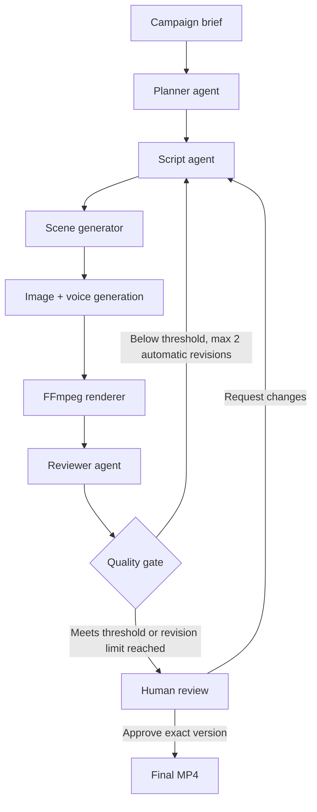
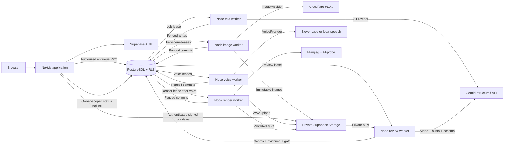

# Creative Director AI

[Live web app](https://creative-director-ai-ochre.vercel.app) ? [GitHub repository](https://github.com/Tapish19/creative-director-ai)

A creative production studio that turns a marketing brief into a planned story, a structured script, generated scene images, spoken narration and a real FFmpeg-rendered MP4. A structured audiovisual review scores the result; feedback-driven revisions, script editing and scene regeneration preserve every version. Owners approve an exact reviewed version, with an auditable decision and final MP4 download.

**Current milestone: Phase 8 implemented; Supabase connected; AI provider credentials and worker hosting pending.** Campaign CRUD, Supabase Auth, Gemini planner/writer agents, Cloudflare FLUX images, ElevenLabs or local speech, durable PostgreSQL jobs, FFmpeg rendering, private playback/downloads, audiovisual AI reviews, quality gates, bounded feedback revisions, script/scene editing, authenticated human approval and persisted attempt history are implemented. Native tests render and decode actual 15- and 30-second videos. Controlled cloud responses and storage transport exist only in tests. The web app is deployed on Vercel and connected to a dedicated Supabase project with all migrations applied. Hosted sign-in, storage and live AI outputs still need end-to-end acceptance. No runtime mock provider is installed.

See the [implementation plan](docs/implementation-plan.md), [text guide](docs/phase-2.md), [image guide](docs/phase-3.md), [voice guide](docs/phase-4.md), [rendering guide](docs/phase-5.md), [review guide](docs/phase-6.md), [revision guide](docs/phase-7.md) and [approval guide](docs/phase-8.md).

## Demo screenshots

These are actual captures of the unconfigured interface:

- [Campaign dashboard](docs/screenshots/dashboard.png)
- [MyHotelLine campaign brief](docs/screenshots/campaign-brief.png)
- Generation workspace screenshot: pending a live run with supplied credentials.
- Video results screenshot: pending a live authenticated campaign. Run `npm run render:smoke` for a real MP4 with labeled test artwork and local narration.

The sample campaign is **MyHotelLine**, cloud-based hotel and restaurant management software for independent hotel owners. Its goal is a free product demo booking through a 15-second social ad about replacing manual booking, billing and room management. “Use sample brief” fills editable inputs; it does not fabricate saved campaigns or generated outputs.

## Architecture



The workflow through human approval is implemented. The web app is deployed; live provider acceptance and background worker hosting remain pending.



## Agent workflow

1. The user saves a validated brief and requests a storyboard.
2. A database transaction snapshots the brief, allocates the next version and enqueues a job. Repeated requests with the same key return the same generation. Multiple clicks while a generation is active also return that generation.
3. A worker claims the job with a fresh lease token. The planner returns audience, pain points, campaign angle, hook, CTA and scene intent.
4. The writer consumes the brief and validated plan, returning a complete script, narration, captions and 3–5 visual prompts.
5. Successful writer output, scene rows, the completed attempt and one image job per scene commit atomically. The generation remains active while its images are queued or running.
6. A failed attempt records a safe error and available diagnostics. Eligible retries are scheduled in the database. A successful plan is reused if the writer fails.
7. The image worker calls Cloudflare FLUX for each scene, validates and center-crops the source to a portrait JPEG, then uploads it to private storage. A fenced transaction publishes the image path and audit record.
8. When all images succeed, narration is queued atomically. A failed image leaves the version `partial`; successful images remain saved and failed scenes can retry independently.
9. The voice worker synthesizes the exact saved narration, validates its PCM WAV frames and measured duration, then uploads privately. Successful narration atomically queues a render job. A speech failure preserves the images and exposes a bounded retry action.

10. The render worker downloads committed assets, animates scenes, burns captions and combines narration/music into an H.264/AAC MP4. FFprobe validates the result before private upload and a fenced render-completion commit that queues review. The owner can play or download it; a failed render preserves all source media.

11. The review worker validates the saved MP4, submits video and audio to Gemini with the brief/script, and saves five scores, feedback and media evidence. The saved threshold routes the version to `awaiting_approval` or `needs_revision`. Review failure preserves the video. Below-threshold reviews can atomically create up to two automatic child versions.

12. Users can regenerate with saved feedback, edit a structured script or regenerate one image. Each action creates a child version; targeted edits reuse unchanged images/narration and render/review a new MP4. Prior outputs remain inspectable.

13. The campaign owner approves a completed reviewed version, acknowledging any below-threshold score. The decision stores the exact video/review identity, checksum, actor and timestamp. Future revisions require their own approval.

Agent inputs include a prompt version and exact submitted prompt; text agents also record their system instructions. Outputs, model identity, token usage when supplied, attempt number and execution time are retained. Image audit records include source/output dimensions, crop mode and storage path. UI inspection is restricted to the generation owner.

## Technology stack

| Layer           | Choice                                                                                 |
| --------------- | -------------------------------------------------------------------------------------- |
| Web             | Next.js App Router, React, strict TypeScript                                           |
| UI              | Tailwind CSS 4, application CSS, Lucide icons                                          |
| Database/auth   | Supabase PostgreSQL, Supabase Auth, `@supabase/ssr`                                    |
| AI text         | Gemini REST API behind `AIProvider`                                                    |
| Contracts       | Zod input/output validation and generated JSON Schema                                  |
| Background work | Node worker, transactional PostgreSQL RPCs, leases and delayed retries                 |
| Testing         | Vitest, PGlite embedded PostgreSQL, Playwright; pgTAP tests for a local Supabase stack |
| Images          | Cloudflare Workers AI / FLUX behind `ImageProvider`, Sharp portrait preparation        |
| Voice           | ElevenLabs behind `VoiceProvider`; Windows speech or eSpeak NG locally                 |
| Video           | FFmpeg behind `VideoRenderer` in a container-capable worker                            |

```text
app/                 Pages, authenticated mutations, status endpoint
components/          Campaign and generation workspace UI
lib/                 Auth, repositories, environment and input validation
services/ai/         Provider contract, Gemini adapter, planner, writer
services/jobs/       Queue adapters and recoverable text/image orchestration
services/images/     Cloudflare provider, portrait preparation and private storage
services/voice/      ElevenLabs/local providers, WAV validation and private audio storage
services/video/      FFmpeg renderer, timing, captions and storage
workers/             Config validation and standalone text/image/voice workers
types/               Campaign, generation, database and creative contracts
supabase/migrations/ Versioned schema, queue RPCs and ownership policies
tests/               Unit, PostgreSQL integration and browser tests
```

## Local setup

Requirements: Node.js 22+, npm and a Supabase project for live use. Install FFmpeg/FFprobe with libx264, AAC and libass, plus Windows speech or eSpeak NG for native tests. See the [rendering setup](docs/phase-5.md).

```powershell
cd C:\Users\Abhishek\creative-director-ai
npm ci
# Copy only if .env.local does not already exist; preserve your credentials.
Copy-Item .env.example .env.local
# Configure the environment and apply all migrations below.
npm run dev
```

Start the text worker in a second terminal:

```sh
npm run worker
```

Start the image worker in a third terminal:

```sh
npm run worker:images
```

Start the voice worker in another terminal:

```sh
npm run worker:voice
```

Start the render worker with `npm run worker:render`, then the reviewer with `npm run worker:review`, each in its own terminal. The reviewer reuses Gemini/Supabase worker credentials and needs FFmpeg/FFprobe.

Without an ElevenLabs key, Windows uses its installed English speech engine; Linux/macOS require eSpeak NG. On Debian/Ubuntu install it with `sudo apt-get install espeak-ng`, or use `brew install espeak-ng` on macOS. `npm run voice:smoke` independently produces a real local MyHotelLine WAV under `artifacts/`, without database or provider credentials.

Open `http://localhost:3000`, create an account, confirm the email, create a campaign and choose **Generate storyboard**. Closing the page does not stop queued jobs. All worker commands accept `-- --once` to process one eligible claim and exit; they do not wait for delayed retries. Each worker runs independently. Images and voice wait in the database until their worker is available.

Without Supabase configuration the dashboard, brief form and setup instructions render, while saving and authentication are disabled. A worker with missing credentials exits with the missing variable names. There is no offline mock generation mode.

## Environment variables

All service credentials stay server-side. `.env*` is ignored except `.env.example`. The web app never reads the service-role key or Gemini API key. Local development may keep all variables in `.env.local`; production should configure web and worker environments separately.

| Variable                    | Runtime       | Purpose                                                             |
| --------------------------- | ------------- | ------------------------------------------------------------------- |
| `SUPABASE_URL`              | Web + worker  | Supabase project URL                                                |
| `SUPABASE_PUBLISHABLE_KEY`  | Web           | Publishable or legacy anon key; never a service-role key            |
| `SUPABASE_SERVICE_ROLE_KEY` | Worker only   | Privileged key for trusted worker RPCs; never expose to the browser |
| `GEMINI_API_KEY`            | Worker only   | Gemini credentials                                                  |
| `GEMINI_MODEL`              | Worker only   | Defaults to `gemini-3.8-flash`; override with a supported model ID  |
| `CLOUDFLARE_ACCOUNT_ID`     | Image worker  | Account running FLUX image inference                                |
| `CLOUDFLARE_API_TOKEN`      | Image worker  | Account-scoped Workers AI token                                     |
| `ELEVENLABS_API_KEY`        | Voice worker  | Optional hosted speech; absent means real local synthesis           |
| `ELEVENLABS_VOICE_ID`       | Voice worker  | Required with a key; voice must be available to that account        |
| `ELEVENLABS_MODEL`          | Voice worker  | Defaults to `eleven_multilingual_v2`                                |
| `LOCAL_TTS_ENGINE`          | Voice worker  | `windows` or `espeak`; blank selects the platform default           |
| `LOCAL_TTS_PATH`            | Voice worker  | Optional executable override                                        |
| `LOCAL_TTS_VOICE`           | Voice worker  | Optional installed voice; default English                           |
| `FFMPEG_PATH`               | Render worker | Optional FFmpeg executable override                                 |
| `FFPROBE_PATH`              | Render worker | Optional FFprobe executable override                                |
| `RENDER_MUSIC_PATH`         | Render worker | Optional local PCM16 mono WAV background music                      |
| `QUALITY_THRESHOLD`         | Review worker | 1-10, one decimal; default 8; frozen on first review claim          |
| `MAX_AUTOMATIC_REVISIONS`   | Review worker | 0, 1 or 2; default 2; frozen per cycle; targeted edits use 0        |

The default text model is listed with a free tier in [Google’s pricing documentation](https://ai.google.dev/gemini-api/docs/pricing), checked October 26, 2026. Cloudflare also documents a [daily free Workers AI allocation](https://developers.cloudflare.com/workers-ai/platform/pricing/). Actual access and quotas depend on your account and may change. Use Cloudflare's Workers AI token template, or include Workers AI Read and Edit permissions as described in its [REST setup guide](https://developers.cloudflare.com/workers-ai/get-started/rest-api/). Provider implementations remain replaceable; no paid text-to-video service is required. Both quality settings are now active; automatic revisions have a hard cap of two.

## Database setup

Apply **all** SQL files in `supabase/migrations` in filename order. When using the SQL editor, execute each file separately: PostgreSQL must commit enum additions before the next migration uses them. Existing Phase 1 installations should apply only the new migrations; do not reapply the initial migration.

| Migration                           | Purpose                                                                                |
| ----------------------------------- | -------------------------------------------------------------------------------------- |
| `202610260001_initial_schema.sql`   | Campaigns, generations, attempts, scenes, reviews, videos, jobs and private storage    |
| `202610260002_script_status.sql`    | Adds the `script_ready` statuses                                                       |
| `202610260003_text_pipeline.sql`    | Idempotent enqueue, leases, attempts, retry scheduling and atomic script completion    |
| `202610260004_draft_policy_fix.sql` | Removes recursive draft-update/delete policies while preserving lineage protection     |
| `202610260005_image_status.sql`     | Adds image-ready and project partial statuses                                          |
| `202610260006_image_pipeline.sql`   | Atomic scene fan-out, image leases, attempts, bounded retries and progress aggregation |
| `202610260007_media_status.sql`     | Adds the images-and-voice `media_ready` state                                          |
| `202610260008_voice_pipeline.sql`   | Private voiceovers, speech queue, leases, retries and media progress                   |

Migrations `202610260009_video_status.sql` and `202610260010_render_pipeline.sql` add `video_ready`, render metadata, the leased queue and bounded retries. Apply 009 separately before 010.

Phase 6 adds `202610270011_review_status.sql` and `202610270012_review_pipeline.sql` for review states, evidence, leased jobs and scoring transactions. Execute 011 separately before 012.

Phase 7 adds `202610270013_revisions.sql` for child-version creation, media provenance, edited-script validation and atomic automatic revisions. Restart all workers after updating the code and schema.

Phase 8 adds `202610270014_human_approval.sql` for owner-only approval, immutable decision records and approved-artifact protection. Apply it before running the updated web app; no additional worker or environment variable is required.

Alternatively, use the Supabase CLI:

```sh
supabase login
supabase link --project-ref YOUR_PROJECT_REF
supabase db push
```

For a real local Supabase stack, Docker and Supabase CLI support `supabase start`, `supabase db reset` and `supabase test db`. That full stack has not been run in this workspace. Database resets are for a disposable development database.

Email/password authentication is enabled. The hosted project uses `https://creative-director-ai-ochre.vercel.app` as Site URL and permits production and localhost `/auth/callback` redirects. Registration uses email confirmation and a PKCE callback. Session cookies are HTTP-only and use secure transport in production. Configure custom SMTP for signup outside the Supabase project team.

Every application table has RLS. Owners can edit/delete ungenerated drafts and read their own generation history. Protected columns and worker RPC grants prevent clients from forging ownership, generated outputs or approval status. Drafts freeze when a generation exists. The lineage helper checks the authenticated owner without recursively entering child RLS policies. Worker writes require a current lease token.

`creative-assets` is a private storage bucket with an owner-prefixed path policy. Images use immutable owner/generation/scene/attempt paths. The preview route uses the owner's session and RLS to issue a 60-second signed redirect, with no shared caching. Signed URLs are never stored in scene rows. Database types currently reflect the checked-in migrations; they can be regenerated using `supabase gen types typescript --linked` once a project is configured.

## How video rendering works

`npm run worker:render` runs the independent `VideoRenderer` implementation. It downloads saved scene images and narration, creates a 720 x 1280 timeline at 30 fps, applies zoom/pan and crossfades, burns scene captions and encodes H.264/AAC with fast-start playback. FFprobe validates exact frame count, dimensions, codecs and duration before private upload. Output is 15 or 30 seconds; no paid video-generation API is used.

Captions use **planned scene timing**, not spoken-word forced alignment. Short narration keeps its natural pace; longer narration may speed up by at most 1.25x. Speech that still cannot fit fails explicitly instead of being truncated. Optional `RENDER_MUSIC_PATH` supplies a worker-local PCM WAV mixed quietly underneath. Subprocesses use argument arrays, fixed filter files, bounded output, cancellation and deadlines. Temporary directories are cleaned after each attempt.

`npm run render:smoke` produces `artifacts/render-smoke/myhotelline-render-test.mp4` without cloud credentials. Its designed artwork is visibly labeled as a render test; narration and the MP4 are real. Setup, output specs and deployment considerations are in the [Phase 5 guide](docs/phase-5.md).

## Evaluation and retry system

The text pipeline uses JSON schemas and semantic checks: 3–5 consecutively numbered scenes, total duration matching the brief, joined scene narration matching the full narration, bounded captions, and English word budgets. Word budgets are an early plausibility check; the renderer also checks measured speech timing. The Gemini adapter rejects arbitrary prose, invalid JSON, truncated responses and blocked output. [Google’s API reference](https://ai.google.dev/api/generate-content) documents the structured generation endpoint.

Each text agent gets at most **3 attempts**, retained across worker restarts. A job gets at most **5 claims** overall. Retries use exponential backoff with jitter and honor `Retry-After`. Credential failures, unsupported requests and safety blocks fail without an automatic retry. A successful planner result survives a writer failure.

Worker leases last 120 seconds and renew every 20 seconds. Each write checks the claim token and expiry. An interrupted claim can be recovered; a crash on the final allowed claim is marked failed. AI calls use a 60-second timeout; database requests use a 10-second timeout. Provider calls are at least once: a crash after an upstream response but before saving it may cause another call, while persisted output writes remain fenced and transactional.

Image jobs have their own three-claim budget per scene. Retryable failures release the worker and persist a delayed retry. After a batch finishes, the owner can restart each failed scene at most twice; every attempt remains in the audit. Successful images are preserved. Cloudflare calls have a 90-second deadline; image-worker storage/database requests have 30-second deadlines. Uploaded bytes are bounded, decoded and normalized before publishing. See the [image operating guide](docs/phase-3.md) for lease recovery and partial states.

Voice jobs also allow three automatic claims and at most two owner restarts. Missing credentials or installed voices fail explicitly; local speech is chosen only when the ElevenLabs key is absent. Local synthesis has a 60-second deadline and ElevenLabs 90 seconds. Audio is validated as non-silent mono PCM WAV before upload. Private playback uses owner-authenticated 15-minute signed URLs with byte-range serving by Storage. See the [voice operating guide](docs/phase-4.md).

Render jobs use the same three-claim/two-owner-restart policy and lease fencing. FFmpeg has a five-minute deadline; database/storage requests have 30-second deadlines. Failed rendering or upload preserves committed images and narration. Playback and download routes issue owner-authorized, 15-minute signed URLs.

Authenticated enqueue is limited to 3 active generations and 20 new generations per account per rolling 24 hours. These limits are enforced in PostgreSQL and can be changed through a migration.

The reviewer evaluates the rendered video and audio, not just script text. Hook strength, clarity, audience relevance and CTA strength are scored 1-10. Overall is their mean, rounded to one decimal and checked in both TypeScript and PostgreSQL. Problems and actionable suggestions are saved with the exact source-video identity. `QUALITY_THRESHOLD` is snapshotted on the first review claim; equality passes to `awaiting_approval`, while lower scores become `needs_revision`. Passing never approves a video. Review jobs have three claims per batch and at most two owner restarts. See the [review operating guide](docs/phase-6.md).

The creative revision loop creates at most **two automatic child versions** after the initial video. It supplies saved feedback and prior scripts to both planner and writer. Passing stops the loop; low scores at the limit require human review. Quota exhaustion preserves the review and records a stop reason. Technical retries do not consume creative revision counts.

Regenerate, Edit script and Regenerate scene create immutable child versions. Targeted edits reuse unchanged media and disable automatic rewrites to preserve the user's scope. Full manual regeneration can start another bounded cycle. All versions, reviews and audit records remain inspectable. See the [Phase 7 guide](docs/phase-7.md).

## Human approval

The owner watches a reviewed version, acknowledges its feedback and selects **Approve version N**. A below-threshold score requires explicit acknowledgment. Approval waits until campaign processing finishes and is bound to the exact reviewed MP4. The audit stores the owner, timestamp, optional note, video/review IDs and checksum. Repeated requests preserve the original decision. New revisions remain unapproved; previously approved versions remain inspectable and downloadable. See the [Phase 8 guide](docs/phase-8.md).

## Verification

```sh
npm run check
npm run format:check
npm run build
npx playwright install chromium
npm run test:e2e
```

Unit tests exercise provider HTTP classifications, invalid JSON, schema failures, deadlines, cancellation, response size limits, prompt repair, image decoding/cropping and authenticated preview signing. Integration tests run all application SQL migrations unchanged in PGlite PostgreSQL with minimal Supabase auth/storage test scaffolding. They verify tenant isolation, draft CRUD, idempotent enqueue, quotas, lease recovery, stale-write rejection, bounded retries, preserved partial output, version history and atomic completion. Image tests cover independent scene failures, upload failures, retry limits, private object visibility and interrupted uploads. Controlled provider responses and storage sinks exist only under tests.

Browser tests run the production build with Supabase deliberately unconfigured. They cover setup, editable sample briefs, navigation, mobile overflow and the status API’s validation/unconfigured behavior. They do not claim to exercise hosted authentication or a live Gemini run. The standalone pgTAP test file is also available for a local Supabase stack; hosted provider verification remains pending credentials.

Native tests synthesize real local speech and render both 15- and 30-second MP4s. They check decoding, exact frame counts, captions, motion, crossfade blending, audio and optional music. Install FFmpeg/FFprobe and the speech engine before `npm test`; Ubuntu CI installs them with fonts. SQL tests cover render recovery, bounded retries and failed publication; route tests verify owner-only downloads. Hosted playback still needs live acceptance testing.

## Deployment instructions

The video milestone needs a Next.js web process, Supabase and long-running Node workers:

1. Apply all database migrations.
2. Deploy the web app with `SUPABASE_URL` and `SUPABASE_PUBLISHABLE_KEY`; build with `npm run build`, start with `npm start`.
3. Run `npm run worker` as a separate process with `SUPABASE_URL`, `SUPABASE_SERVICE_ROLE_KEY`, `GEMINI_API_KEY` and optionally `GEMINI_MODEL`. Keep the project source and `tsconfig.json` available to `tsx`; it is a runtime dependency.
4. Run `npm run worker:images` as a separate process with the Supabase worker credentials and Cloudflare account/token. Include Sharp's native dependencies for the deployment OS; install dependencies on that OS rather than copying Windows `node_modules`.
5. Run `npm run worker:voice` with Supabase worker credentials. Install eSpeak NG in a Linux worker image, or configure ElevenLabs key/voice ID. Keep `scripts/synthesize-windows.ps1` available for Windows workers. Never interpolate user narration into shell commands.
6. Run `npm run worker:render` on a native Node/container host with FFmpeg, FFprobe, fonts and writable temporary disk. Use the Supabase worker credentials and optional music/executable paths.
7. Run `npm run worker:review` with Gemini, Supabase worker credentials, FFmpeg/FFprobe and `QUALITY_THRESHOLD` and `MAX_AUTOMATIC_REVISIONS` (0-2). Use the same configuration across replicas.
8. Configure the deployed origin and `/auth/callback` in Supabase Auth.
9. Test a real MyHotelLine generation, play/download its MP4 and verify another account cannot access its rows or private images/audio/video before sharing the app.

A platform may sleep a free worker, leaving jobs queued until it wakes. Serverless request handlers are not a substitute for this worker process. Rendering needs a container-capable worker with FFmpeg; local speech also needs its installed engine. Cloudflare Workers cannot execute the native FFmpeg subprocess. The web app is deployed at https://creative-director-ai-ochre.vercel.app from the GitHub-connected `main` branch. The background workers are not deployed. See [Vercel deployment](docs/deployment.md) for the remaining configuration.

## Design decisions

- **Provider abstraction:** agent prompts and creative contracts do not depend on Gemini request/response types.
- **Short enqueue requests:** the web server validates/authenticates and schedules work; it does not hold an HTTP request open for generation.
- **Durable partial progress:** each successful stage commits before the next stage starts.
- **Fenced worker writes:** expired workers cannot overwrite results after another worker reclaims the job.
- **Versioned briefs:** each request saves an immutable brief snapshot and distinct version. Revisions link to their source and retain feedback; targeted edits reference unchanged private media.
- **Honest UI states:** the generation page distinguishes a completed script from a completed video. Missing credentials do not activate a fake provider.
- **Testable persistence:** local PostgreSQL tests found and fixed the initial draft-policy recursion before live database use.

## Known limitations

- Live hosted Supabase authentication/storage and Gemini/Cloudflare/ElevenLabs outputs still require credentials and validation.
- PGlite verifies SQL behavior, but does not reproduce the full hosted Supabase Auth, Storage or PostgREST services.
- Human approval is version-specific and permanent; revocation, team approval and external ad publishing are not implemented. Quality scores never approve a video automatically.
- Revision scores may not improve monotonically. Targeted edits keep automatic rewrites off; full Regenerate starts a new bounded cycle.
- AI scores are subjective and uncalibrated until live evaluation. Video sampling and compressed review copies can miss details; scores do not predict ad performance.
- Real local Windows speech has been verified. Linux eSpeak is wired into CI but was not executed on this Windows host. Local voice naturalness and pronunciation vary; the UI identifies it as local synthesis.
- FLUX Schnell does not document width/height inputs. Sources are center-cropped to portrait; composition and subject consistency across independently generated scenes need live review.
- An interrupted upload/commit may leave an unreferenced private object. Automated orphan cleanup is not implemented; use a retention job that reconciles against all committed image/audio/video paths before scaling storage.
- Real local MP4s have been produced; the deployed setup pages have been verified; an authenticated, live AI-generated campaign remains unverified.
- Website URLs are stored as reference; no website content is fetched or researched.
- Narration is English-focused. Captions follow storyboard timing, so exact spoken-word alignment is not provided. Overlong speech can require a shorter script.
- A response that meets structural constraints can still be creatively weak or factually wrong; AI review does not replace human inspection and approval.
- The version list displays the most recent 50 versions. Older versions remain stored and accessible by their direct URL.
- A worker crash can repeat an upstream AI request. Paid account usage is not guaranteed exactly once.
- Account recovery, teams, billing and analytics are outside the current scope.
