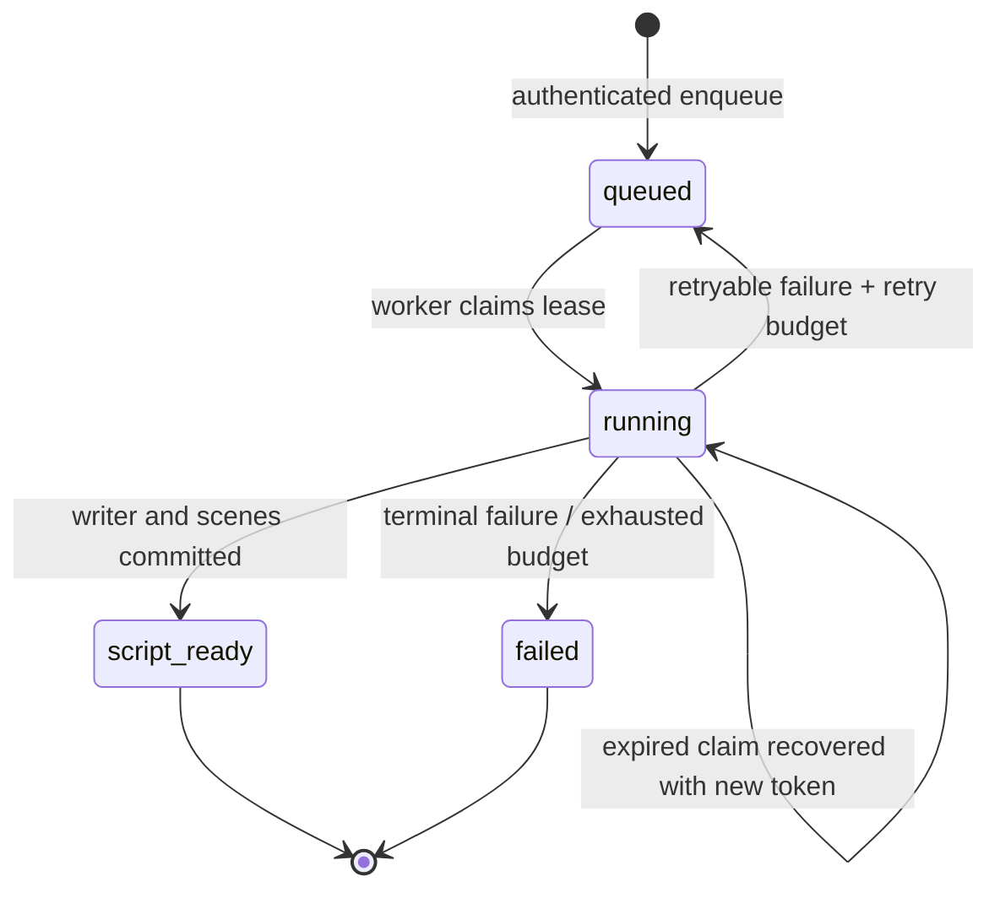

# Phase 2: planner, writer and durable text generation

This guide describes the text stage. Phase 3 now automatically queues image jobs after script completion; see the [image guide](phase-3.md) for the additional migrations and worker. A generation stays active until its image batch finishes.

## Start a live run

1. Apply all SQL migrations, in order, as separate migrations/transactions.
2. Set the web variables: `SUPABASE_URL` and `SUPABASE_PUBLISHABLE_KEY`.
3. Set worker variables: `SUPABASE_URL`, `SUPABASE_SERVICE_ROLE_KEY`, `GEMINI_API_KEY`; optionally override `GEMINI_MODEL`.
4. Start `npm run dev` and, in a second terminal, `npm run worker`.
5. Sign up, confirm email, sign in, and create the MyHotelLine sample campaign.
6. Choose **Generate storyboard**. The page polls owner-authorized persisted state.
7. Inspect the creative direction, full script, narration, 3–5 scenes, captions and prompts. Expand the execution log for agent inputs, outputs, attempts, model and token usage.

No keys are needed for `npm test`. Those tests use an embedded PostgreSQL database and controlled HTTP fixtures, not the application runtime or external accounts.

## State transitions

`script_ready` means text and scene definitions exist. It does not mean video, audio, quality review or approval exists.

## Failure behavior

| Condition                                              | Result                                                              |
| ------------------------------------------------------ | ------------------------------------------------------------------- |
| Gemini key missing                                     | Worker refuses startup and names missing variables                  |
| Worker offline                                         | Job stays queued; page can be closed safely                         |
| Invalid JSON, schema or duration                       | Failed attempt saved; validation feedback included in bounded retry |
| HTTP 429                                               | Retry respects `Retry-After` and persists the next eligible time    |
| HTTP 5xx or timeout                                    | Retry with exponential backoff and jitter                           |
| Credentials rejected, missing model or blocked content | Fail without automatic retry                                        |
| Writer fails after planner succeeds                    | Saved plan retained and reused                                      |
| Worker dies                                            | Expired lease reclaimed; interrupted running attempt marked failed  |
| Old worker returns after lease expiry                  | Its write is rejected                                               |
| Final claim dies                                       | Recovery marks the job/generation failed                            |
| Browser loses connection                               | Polling pauses after 3 failures; explicit reconnect action remains  |
| Same request submitted twice                           | Same generation returned; no duplicate job                          |
| New request after completion/failure                   | New version; prior inputs, outputs and errors retained              |

The maximum is three attempts per agent and five worker claims per generation. These are transport/contract retries. The maximum-two creative revision loop is a separate later phase.

## Live acceptance checklist

This checklist is pending real credentials:

- Confirm email/password login and cookie renewal on the actual Supabase project.
- Create, edit, reload and delete an ungenerated campaign.
- Apply every migration and regenerate/compare database types.
- Generate a MyHotelLine plan/script against the configured Gemini model.
- Confirm durations and spoken copy, and inspect provider/model provenance.
- Close the browser mid-generation and verify the worker still finishes.
- Restart the worker while a job is running and verify recovery after lease expiry.
- Confirm a second account cannot read the campaign, status endpoint, scenes or attempt log.
- Create a second version and inspect both versions without changing the original.

## References

- [Gemini structured outputs](https://ai.google.dev/gemini-api/docs/structured-output)
- [Gemini generateContent API](https://ai.google.dev/api/generate-content)
- [Gemini model access and pricing](https://ai.google.dev/gemini-api/docs/pricing)

Provider documentation was checked October 26, 2026. The configured model and free-tier quota still need verification with the user's account.
