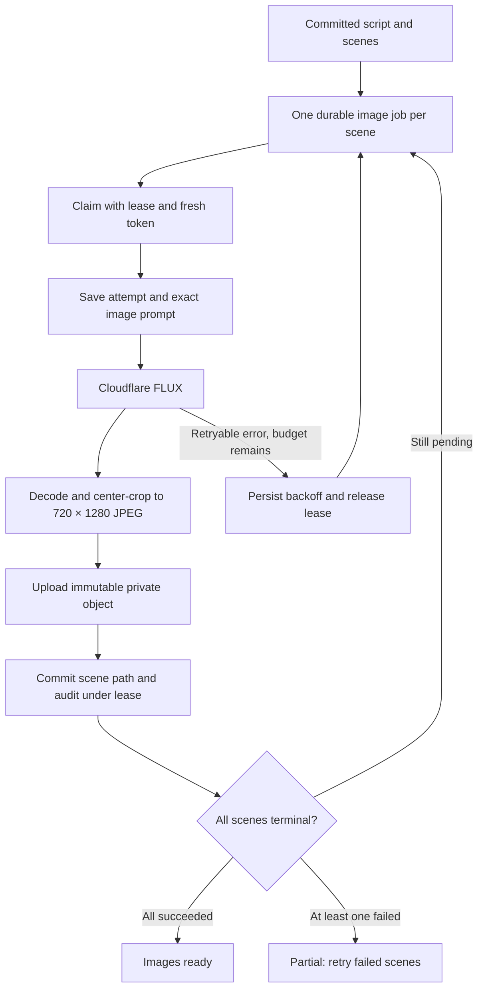

# Phase 3: scene images

Phase 4 now queues narration automatically after image success. New generations stay active until voice completes and then reach `media_ready`; historical `images_ready` versions have a manual voice action. See the [voice guide](phase-4.md). The image-stage behavior and original phase verification below remain applicable.

The image pipeline is implemented with Cloudflare Workers AI / FLUX, a durable job per scene, private storage and authenticated previews. Live Cloudflare generation and hosted Supabase upload/signing remain pending credentials. Controlled provider responses and an in-memory upload sink exist only in tests; production has no mock image fallback.

## Run it

1. Apply migrations `202610260005_image_status.sql` and `202610260006_image_pipeline.sql`, after migrations 001–004. Execute each migration separately so new enum values commit before use.
2. Configure the image worker with `SUPABASE_URL`, `SUPABASE_SERVICE_ROLE_KEY`, `CLOUDFLARE_ACCOUNT_ID` and `CLOUDFLARE_API_TOKEN`. Keep provider and service-role keys out of the web deployment.
3. Create a Cloudflare token with Workers AI access for the selected account. Follow the [official REST setup guide](https://developers.cloudflare.com/workers-ai/get-started/rest-api/).
4. Run `npm run worker` for text and `npm run worker:images` in another terminal for images. Both processes can share `.env.local` during development. `-- --once` processes one eligible claim and exits.
5. Create a campaign and select **Generate storyboard**. Successful script completion queues all scene images in the same database transaction. Existing Phase 2 script-ready versions have a **Generate scene images** action.

Missing image-worker credentials cause a startup error naming the missing variables. They do not consume scene attempts. The text worker can run independently; queued images wait until an image worker starts.

## Processing and persistence



Cloudflare's [FLUX Schnell contract](https://developers.cloudflare.com/workers-ai/models/flux-1-schnell/) documents a prompt, diffusion steps and base64 output. The adapter sends only documented generation fields. The portrait service decodes PNG/JPEG, bounds source dimensions, strips metadata and center-crops to 720×1280 JPEG. It does not claim the model natively generated a portrait. The prompt keeps subjects within a central vertical safe area, but cropping can still cut off details. The exact submitted prompt and crop/source dimensions are retained in the audit.

Each image job gets at most three automatic claims. Retryable HTTP, decode and upload failures use exponential backoff with jitter and honor `Retry-After`; credential rejection is terminal. A user can restart a failed scene twice, after the whole batch has finished. Each restart gets a fresh budget of three claims, so there are at most nine claims per scene. Cumulative attempt numbers and audit records are retained. Successful scenes are never regenerated by a failure retry. Creative regeneration of an already successful scene, with a new version, remains Phase 7.

All jobs use 120-second leases renewed every 20 seconds. Cloudflare requests have a 90-second deadline; image-worker database/storage requests have 30-second deadlines. `FOR UPDATE SKIP LOCKED` allows separate workers to claim different scenes. Generation-level locking serializes progress aggregation. A crash on the final claim becomes a failed scene when a worker next polls. A batch is `images_ready` when every scene succeeds, or `partial` when all scenes finish and any failed. Pending/running scenes keep the generation active and prevent a competing version from starting.

## Asset access

Objects live in private bucket `creative-assets` at:

```text
<owner UUID>/<generation UUID>/<scene UUID>/<agent-run UUID>.jpg
```

Uploads never overwrite an existing object. The database commit checks this exact path and the worker's lease. An old worker cannot replace the published image. The database stores object paths, never signed URLs. `/api/scenes/[id]/image` authenticates the user, reads the scene through RLS and signs the object using that user's session, then returns a noncached redirect with a 60-second signed URL. Signed URLs are bearer links valid until expiry; do not share them as permanent public assets. See [Supabase private storage](https://supabase.com/docs/guides/storage/serving/downloads).

An upload followed by a lost lease or uncertain database response can leave an unreferenced private object. The worker intentionally does not delete it: the commit may have succeeded despite a lost response. Automated orphan cleanup is not implemented; add a retention job that reconciles storage with committed scene paths before larger deployments. No orphan is shown as a successful scene result.

## Verification

Local phase gate passed: lint with zero warnings, TypeScript, 110 unit/integration tests, production build, and 10 Playwright browser tests. Browser tests cover the unconfigured workspace, setup instructions, mobile layout and preview-route validation; they do not substitute for the hosted acceptance checks below.

Local tests execute all migrations in embedded PostgreSQL and exercise actual Cloudflare response parsing and actual Sharp image decoding/cropping. Only external HTTP responses and storage transport are substituted. Coverage includes automatic fan-out, independent failures, rate limits, retry budgets, lease recovery, last-claim crashes, stale-write rejection after upload, atomic commits, ownership, private-object visibility and legacy script-ready migration. Preview route tests cover authentication, ownership, short-lived signing and sanitized failures.

Hosted acceptance remains pending:

- Run a real MyHotelLine storyboard and confirm three scene images arrive in private storage.
- Inspect the actual subject framing and caption space on mobile and desktop.
- Check that a second account cannot view scene rows or retrieve image redirects.
- Stop/restart an image worker during generation and confirm recovery.
- Check image upload/signing against the hosted Storage API and account quotas.

Cloudflare currently documents a free daily allocation, with account-dependent limits. This is not unlimited generation. See [current pricing](https://developers.cloudflare.com/workers-ai/platform/pricing/). There is no paid video-generation dependency. Voice, FFmpeg rendering, evaluation, approval and deployment remain later phases.
