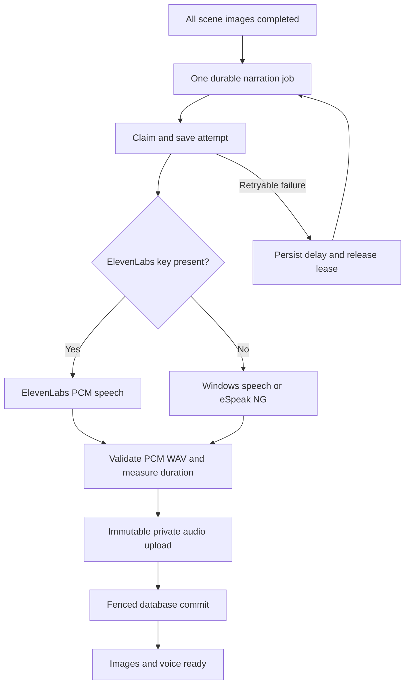

# Phase 4: real voice generation

The voice worker produces real spoken narration, validates the WAV frames, uploads privately and records the measured duration. The default local engine needs no speech API key. ElevenLabs is selected when its API key is present; it also requires a voice ID available to that account. Provider errors never silently switch the voice.

## Setup

1. Apply migrations `202610260007_media_status.sql` and `202610260008_voice_pipeline.sql` after 001–006. Apply them separately so the enum changes commit first.
2. Set `SUPABASE_URL` and `SUPABASE_SERVICE_ROLE_KEY` for the voice worker. Keep the service-role key and voice API key out of the web deployment.
3. Choose the provider through the worker environment:
   - With `ELEVENLABS_API_KEY`, set `ELEVENLABS_VOICE_ID`. `ELEVENLABS_MODEL` defaults to `eleven_multilingual_v2`. Access and quotas depend on the account.
   - Without that key, Windows uses installed English `System.Speech` voices. Linux/macOS use eSpeak NG. On Debian/Ubuntu, install with `sudo apt-get install espeak-ng`; on macOS, `brew install espeak-ng`.
4. Optional local overrides: `LOCAL_TTS_ENGINE=windows|espeak`, `LOCAL_TTS_PATH` for the executable, `LOCAL_TTS_VOICE` for an installed voice. For Windows, the executable must be Windows PowerShell with `System.Speech`, not PowerShell Core. Local eSpeak speech is functional and can sound robotic.
5. Run `npm run worker:voice` alongside the text and image workers. `-- --once` processes one available voice claim and exits.

Run `npm run voice:smoke` to synthesize the MyHotelLine narration locally, without Supabase or any API credentials. It explicitly uses the platform-default local engine and writes `artifacts/myhotelline-voice.wav`; it never calls ElevenLabs. The generated artifact is ignored by Git. On this Windows machine it produced a 9.2-second, 22,050 Hz mono WAV. Duration and pronunciation vary by installed voice.

See the official [ElevenLabs speech endpoint](https://elevenlabs.io/docs/api-reference/text-to-speech/convert), [Windows WAV synthesis API](https://learn.microsoft.com/en-us/dotnet/api/system.speech.synthesis.speechsynthesizer.setoutputtowavefile) and [eSpeak NG project](https://github.com/espeak-ng/espeak-ng).

## Workflow and persistence

The `voiceovers` table stores the exact script narration, provider/model/voice selection, private object path, duration, sample rate, size, attempts and errors. RLS grants only owner reads; authenticated clients cannot write audio output or success states. All attempts remain in `agent_runs` and jobs in `jobs`. `videos` stays reserved for actual rendered output.

Image completion now queues voice atomically. The generation remains `running` until audio completes, then becomes `media_ready`. This means the assets are ready for the rendering phase, not that a video exists. A terminal speech failure produces `partial`, preserving all images and the script. Owners can restart a failed voiceover twice, with three automatic claims per cycle. Credential/install failures are terminal; transient network, audio validation and upload failures retry with exponential backoff and `Retry-After`. Only failed voiceovers can retry; editing or creatively regenerating a successful voice remains Phase 7.

Old Phase 3 `images_ready` versions show a **Generate voiceover** action. Migration 008 does not automatically restart historical versions or incur provider calls for them.

## Audio integrity and subprocess safety

- ElevenLabs returns 22,050 Hz raw PCM, wrapped in a WAV header. Local engines write PCM WAV directly. The application accepts only mono, 16-bit uncompressed PCM at 8–48 kHz, up to 120 seconds and 12 MiB. Invalid headers, inconsistent frames and effectively silent audio are rejected.
- Duration comes from sample frames, not a word-count estimate. A narration exceeding the brief duration is flagged in the UI and audit. Phase 4 does not truncate speech or claim final video synchronization; Phase 5 must reconcile scene timing, pauses and transitions.
- Local synthesis uses argument arrays and fixed scripts with `shell: false`. Narration is passed in a UTF-8 data file, never interpolated into shell code or interpreted as SSML. Windows processes are hidden. Per-attempt temporary directories are checked and removed after synthesis; the audio is kept in memory for upload.
- Local synthesis has a 60-second deadline; ElevenLabs has 90 seconds. Worker database/storage requests have 30-second deadlines. Leases last 120 seconds and renew every 20 seconds.
- Private object paths are `<owner>/<generation>/voice/<attempt>.wav`. A stale worker cannot overwrite another attempt. As with images, ambiguous upload/commit failures can leave unreferenced private objects; a retention/reconciliation task remains future operational work.

## Playback

The workspace labels local vs ElevenLabs synthesis, shows measured duration and provides an accessible native audio player alongside the transcript. Playback authenticates through `/api/generations/[id]/voice`, reads through RLS and issues a private, noncached redirect to a 15-minute signed Storage URL. Storage handles byte-range requests for seeking. Expired or failed playback can be reloaded without regenerating audio. Signed URLs remain bearer links until expiry; only paths are persisted.

## Verification and limits

The local phase gate passed: lint with zero warnings, TypeScript, formatting, 144 unit/integration tests, production build and 12 Playwright browser tests. The real MyHotelLine local WAV was also generated successfully. Browser tests use an unconfigured workspace; authenticated audio playback remains a separate hosted acceptance check.

Tests cover provider selection, HTTP failures, invalid/silent WAV output, actual local synthesis, queue chaining, idempotency, capped retries, stale writes, worker crashes, storage failures, metadata rollback and tenant isolation. The CI workflow installs eSpeak NG on Ubuntu before running the real local synthesis test. Windows synthesis was executed here; the Linux CI job and live ElevenLabs/hosted Supabase playback have not been executed in this workspace.

Live acceptance after credentials are supplied: generate a full MyHotelLine storyboard and voiceover, listen for pronunciation and pacing, verify a second account cannot access playback, exercise browser seeking and expired-link reload, and run the selected ElevenLabs voice if desired. Native audio controls and server-side signed access are implemented; authenticated browser playback awaits hosted Storage credentials.

Voice naturalness depends on the provider. The local fallback is intentionally identifiable. Word-level alignment, per-scene speech timing, voice cloning, background music and the final MP4 are outside this phase.
