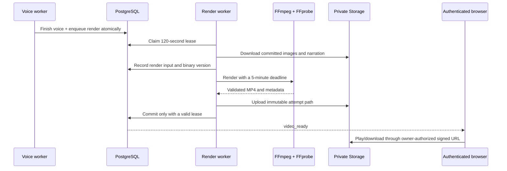

# Phase 5: real FFmpeg video rendering

With the [Phase 6 migrations](phase-6.md) installed, successful renders now queue review automatically and the generation enters `reviewing`. The `video_ready` endpoint described below is the Phase 5 milestone and remains supported for legacy generations; the completed video stays playable throughout review.

The render worker combines saved scene images and narration into a real portrait MP4. No text-to-video API is used. Local 15- and 30-second renders have been decoded and inspected; hosted end-to-end generation still needs Supabase and AI credentials. Reviewer scores, feedback regeneration and approval are later phases.

## Run locally

Install Node.js 22+, dependencies, FFmpeg, FFprobe and a local speech engine for the smoke test. FFmpeg must include `libx264`, AAC, libass, `zoompan`, `xfade`, `loudnorm` and `atempo`. The worker checks these before claiming jobs.

On Ubuntu/Debian:

```sh
sudo apt-get update
sudo apt-get install -y ffmpeg fonts-liberation espeak-ng
```

On Windows, install a full/essentials build from the [FFmpeg download page](https://ffmpeg.org/download.html) and put its `bin` directory on PATH. Alternatively, from this repository:

```powershell
powershell -NoProfile -File scripts/install-ffmpeg.ps1
```

The script downloads a Gyan essentials release and checks its published SHA-256 digest. This workspace's network could not download GitHub release assets. The following explicit development alternative uses pinned Python/npm binary distributions and worked here:

```powershell
powershell -NoProfile -File scripts/install-ffmpeg.ps1 -RegistryFallback
```

The alternative requires Python/pip, npm and tar on Windows x64. It installs `imageio-ffmpeg==0.6.0` (FFmpeg 7.1) and `@ffprobe-installer/win32-x64@5.1.0` under ignored `.tools/ffmpeg`. Keep a maintained FFmpeg installation on production hosts; these pinned development packages are not an automatic security update mechanism. License files remain with the downloaded packages.

`FFMPEG_PATH` and `FFPROBE_PATH` can name explicit executable paths. Otherwise Windows discovers workspace-local binaries, then uses PATH. A worker starts with:

```sh
npm run worker:render
```

It needs `SUPABASE_URL` and `SUPABASE_SERVICE_ROLE_KEY`. Apply migrations **009 and 010**, separately and in order, after the earlier migrations. Run the text, image and voice workers too for the complete pipeline. `npm run worker:render -- --once` handles one available claim and exits.

For an independent rendering check without cloud credentials:

```sh
npm run render:smoke
```

Output: `artifacts/render-smoke/myhotelline-render-test.mp4`. The sample uses real local narration and clearly labeled, designed placeholder artwork. It is a renderer test, not a claimed live AI campaign. Real campaign jobs always download their previously generated, private scene assets.

## Rendering contract

- Output: 720 × 1280, 30 fps, H.264/yuv420p, AAC stereo at 48 kHz, fast-start MP4.
- Duration: exactly 450 or 900 frames for a 15- or 30-second brief. FFprobe also checks stream/container duration, codecs, dimensions and a 100 MiB size ceiling before publication.
- Images: 3–5 completed scenes, decoded with Sharp into fixed portrait JPEGs; each receives an alternating slow zoom/pan.
- Transitions: crossfades add overlapping frames while preserving the requested total frame budget. The last frame is padded before the exact trim to compensate for crossfade boundary rounding.
- Captions: ASS text burned into the lower portion of the frame, word-wrapped and timed to the planned scene boundaries. ASS control syntax is neutralized. **This is storyboard timing, not forced alignment to spoken words.** Review pacing before using the ad.
- Narration: duration is measured from real PCM frames. Short speech stays at its natural pace and the remaining timeline is padded. Slightly long speech can accelerate up to 1.25× to fit with a 0.25-second tail; longer speech fails with an actionable error instead of being cut off. Loudness is normalized.
- Music: optional `RENDER_MUSIC_PATH` points to a trusted worker-local mono PCM16 WAV (8–48 kHz, at most 12 MiB and 120 seconds). Supply music you can use. It loops quietly beneath the narration, fades at the boundaries and is peak-limited. No music is bundled or downloaded automatically.

The implementation uses the [FFmpeg filter reference](https://ffmpeg.org/ffmpeg-filters.html) for zoom/pan, crossfades, ASS subtitles, audio tempo and mixing. Scene data is passed through fixed files and subprocess argument arrays, with no shell interpolation or user-controlled filter commands.

## Durable execution and private delivery



Leases renew every 20 seconds; a stale token cannot publish a result. Failed renders keep all images and narration. There are three automatic claims for retryable failures and two owner-requested restarts after terminal failure. Every attempt retains its inputs, safe failure or output metadata, timing and provider version. Successful metadata includes a SHA-256 checksum, codecs, frame size, narration tempo and whether music was used.

Legacy `media_ready` versions expose **Render video**. New voice completions enqueue automatically. Failed renders expose **Retry render** within the retry limit. Successful versions become `video_ready`, which is distinct from reviewed or approved.

The web app never uses the service-role key. It authenticates the viewer, reads the video through RLS, checks the owner/generation storage prefix, then issues a 15-minute signed URL. Storage serves range requests and download attachments. The signing route uses private, no-store responses. Expired playback can be reloaded without regenerating the video.

## Failure handling and operations

Native processes run without a shell or visible console, with bounded captured output, cancellation and a five-minute render deadline. Each attempt gets an isolated temporary directory. Normal completion, errors and cancellation clean it up after verifying it is inside the expected temporary root. A machine crash can leave temporary files; a host retention policy should remove old `creative-director-*` directories when no worker owns them.

Missing executables fail startup before queue claims. Transient rendering/upload failures schedule bounded retries. Oversized/corrupt media, excessive narration duration and missing codecs produce explicit errors. An upload followed by an interrupted database commit can leave an unreferenced private object; automated storage reconciliation is not implemented. Never delete objects still referenced by saved generation records.

Each worker processes one render at a time. Run it on a VM or container with native FFmpeg, fonts, writable temporary disk and enough CPU/memory for 720p rendering; benchmark resource limits on your host. It cannot run as a native subprocess in a Cloudflare Worker or a short-lived web request. Set provider and service-role credentials only in the workers' environments.

## Verification

`npm test` includes real native 15- and 30-second renders, decoding, exact frame counts, visible caption pixels, changing camera frames, crossfade blending, non-silent audio and optional music. SQL integration tests use controlled media transport to isolate lease recovery, retry caps, immutable publication, owner access and partial failures. These test substitutes are never selected by the application.

Run `npm run lint`, `npm run typecheck`, `npm test`, `npm run build` and `npm run test:e2e`. Browser smoke tests cover the unconfigured production interface; they do not substitute for live authenticated playback. Before deployment, supply credentials, generate a MyHotelLine campaign, play/download its MP4, compare pacing with the storyboard and verify a second account cannot access it.
