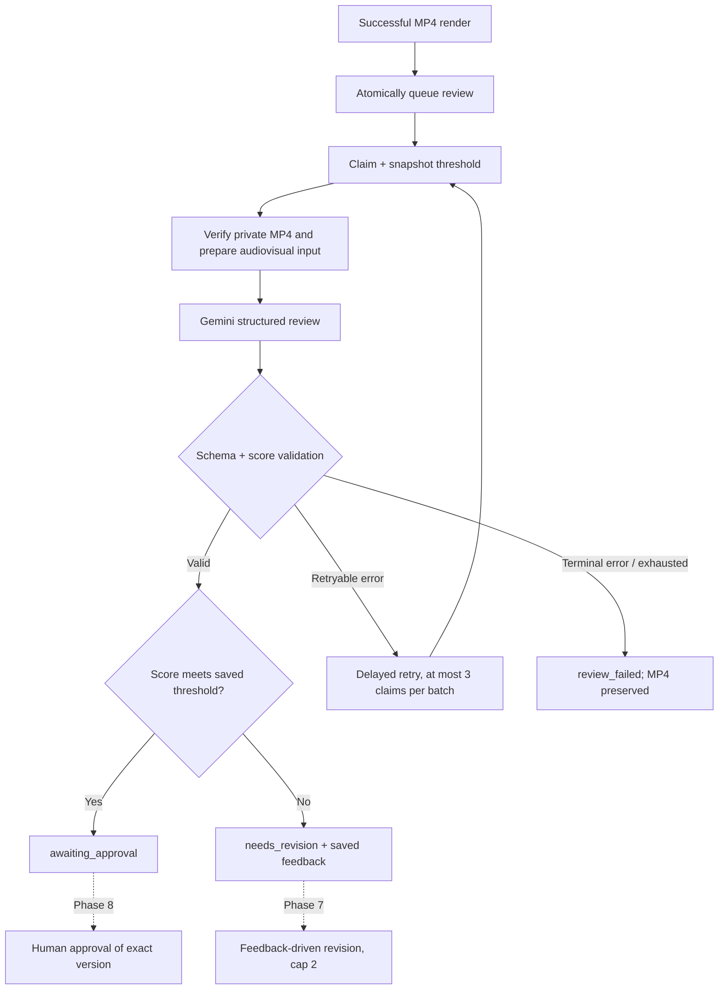

# Phase 6: audiovisual creative review

With [Phase 7](phase-7.md) installed, low scores can queue bounded feedback revisions automatically. Targeted edits keep that loop off, and completed versions remain inspectable. The lifecycle below describes the Phase 6 boundary; the Phase 7 guide documents current regeneration behavior.

The reviewer evaluates the **completed MP4, including its audio**, against the saved brief and script. It returns validated scores, problems and improvement suggestions. The UI displays these alongside the playable video and version history. No runtime fixture or invented score is used. Live Gemini reviews and hosted delivery still await credentials.

## Start the reviewer

Apply migrations `202610270011_review_status.sql` and `202610270012_review_pipeline.sql` after all earlier migrations. Execute 011 separately so enum additions commit before 012 uses them. Existing completed `video_ready` versions expose **Review video**; newly completed renders queue review automatically.

The worker needs:

```dotenv
SUPABASE_URL=your-project-url
SUPABASE_SERVICE_ROLE_KEY=your-worker-only-key
GEMINI_API_KEY=your-key
GEMINI_MODEL=gemini-3.8-flash
QUALITY_THRESHOLD=8
```

It loads `.env.local` for local development. Keep service-role and provider keys in worker environments only. FFmpeg/FFprobe must be installed as described in [Phase 5](phase-5.md). Run:

```sh
npm run worker:review
# One eligible claim, for diagnostics:
npm run worker:review -- --once
```

Run all five workers (text, images, voice, render, review) for a complete generation. Missing credentials fail explicitly; queued work is durable until its worker becomes available.

## Scoring contract

The versioned prompt evaluates actual opening impact, readable/paced audiovisual storytelling, audience relevance and the final action. The brief, script and any instructions embedded in media are treated as content, not reviewer instructions. The adapter requests JSON Schema output; Zod validates it, the pipeline validates again independently of the provider, and PostgreSQL checks critical invariants before publication.

| Field                | Meaning                                                                |
| -------------------- | ---------------------------------------------------------------------- |
| `hook_strength`      | Attention and relevance of the opening 0–3 seconds                     |
| `clarity`            | Understandability, captions, narration and pacing                      |
| `audience_relevance` | Fit between the actual creative, product and intended audience         |
| `cta_strength`       | Explicit action aligned with the campaign goal                         |
| `overall_score`      | Arithmetic mean of the four dimensions, rounded half up to one decimal |
| `problems`           | Specific observed weaknesses, preferably located by scene/timestamp    |
| `suggestions`        | At least one concrete, actionable improvement                          |

All scores must be 1–10 with at most one decimal. Feedback entries are nonempty and bounded to 500 characters; each list holds at most 20. A below-threshold review must name a problem. A structurally valid but inconsistent mean is rejected and receives a bounded repair attempt. No Markdown/prose extraction is used.

`QUALITY_THRESHOLD` defaults to 8 and accepts one decimal. The **first review claim** snapshots the configured threshold onto the generation. Later attempts, worker restarts and manual retries retain that value. Use the same configuration across review worker replicas. The rubric does not reveal the threshold to the model; application code makes the gate decision.

## Quality gate and lifecycle



Passing the threshold does **not** approve the video. Phase 6 never writes `approved_at`, `approved_by` or an approved status. Below-threshold results remain inspectable without automatic regeneration. Existing **Generate a new version** still starts from the brief; it does not yet consume feedback. Phase 7 will add feedback-driven regeneration and the two-revision cap; Phase 8 will add approval.

## Media evidence and privacy

The provider-neutral `AIRequest` supports a typed MP4 attachment. The Gemini adapter converts this to inline video data alongside the prompt and JSON schema, using the documented [video-understanding API](https://ai.google.dev/gemini-api/docs/video-understanding) and [structured outputs](https://ai.google.dev/gemini-api/docs/structured-output). Video and audio are sent to the configured AI provider for evaluation, which can consume provider quota.

The worker downloads only the committed private video belonging to this generation. It verifies the stored SHA-256 when available, and FFprobe checks dimensions, duration and audiovisual streams. Files up to 12 MiB are submitted unchanged. Larger files receive a temporary 360×640/15 fps H.264/AAC copy with bounded bitrate and retained audio; the original stored MP4 is untouched. The submission limit keeps the base64 payload below the older 20 MB request ceiling as well as current higher limits. There is no public URL or separate persistent Gemini Files upload.

Audit records retain the exact prompt/system instructions, prompt version, threshold, source path/video ID, source and submitted hashes, whether compression was used, dimensions, model, usage and timing. Binary/base64 media is not stored in the audit. The UI identifies compressed-copy reviews. Completed reviews are immutable and owner-readable through RLS; clients cannot write scores or call worker RPCs.

## Errors and recovery

Review jobs use 120-second leases renewed every 20 seconds. Gemini requests have a 120-second deadline; optional transcoding has a 120-second deadline. Storage/database requests have 30-second deadlines. Cancellation or loss of lease prevents publication. Expired work can be reclaimed; a crash on the final claim becomes `review_failed` while preserving the video.

HTTP 429 honors `Retry-After`. Transient network/server errors and invalid JSON/schema responses schedule exponential backoff with jitter. The latest validation issues are included in the next prompt. Credential rejection, blocked content or invalid media fail without a transport retry. Each automatic batch has three claims; owners may restart a terminal review at most twice. These transport/output-repair attempts are separate from creative revisions.

Reviews, overall generation score, gate status, task completion and agent output commit in one fenced transaction. A commit failure is not converted into a model failure. A model request may be repeated after a crash; upstream usage is at least once. Finished images, narration and videos are never discarded by a review error.

## Validation and limitations

Tests execute all SQL migrations in embedded PostgreSQL, covering exact threshold equality, low-score feedback, immutable threshold snapshots, ownership, atomic commits, invalid scores/evidence, retries, crash recovery and cancellation. Native FFmpeg tests verify unchanged small-file evidence and an actual compressed audiovisual copy of a larger valid MP4. Provider HTTP responses are controlled test fixtures; no live review score has been measured yet.

Run `npm run lint`, `npm run typecheck`, `npm test`, `npm run build` and `npm run test:e2e`. Before sharing the project, supply credentials, generate MyHotelLine end to end, compare the review to the actual video, test playback with a second account, and check usage in the provider console.

AI review is subjective, can be influenced by embedded content despite prompt defenses, and is not an ad-performance prediction or factual verification service. Gemini samples video, so it may miss brief frames or precise subtitle timing. A compressed review copy further reduces visual detail. Human inspection remains necessary. Reviewer quality and score calibration need evaluation with live creatives; automated schema and lifecycle tests do not establish creative accuracy.
