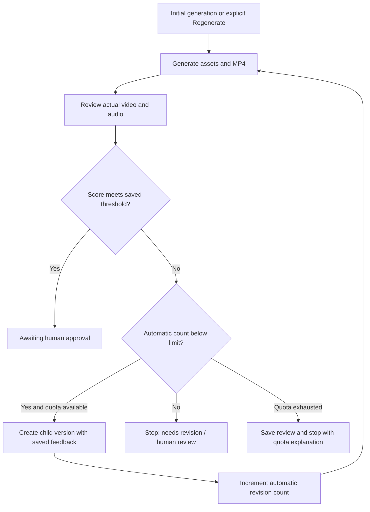

# Phase 7: regeneration, editing and version lineage

Creative changes always create a **new generation**. The source brief, script, images, narration, MP4, review and agent history remain inspectable. Completed artifacts are never overwritten in place. Live cloud acceptance still requires the deferred credentials; local tests exercise the real database transitions and provider contracts.

## Available actions

| Action                     | What runs again                                           | What is preserved/reused                                                                       |
| -------------------------- | --------------------------------------------------------- | ---------------------------------------------------------------------------------------------- |
| **Regenerate**             | Planner, writer, all images, voice, renderer and reviewer | Saved brief; previous script/review and optional user direction are passed to both text agents |
| **Edit script**            | Changed visuals, changed narration, renderer and reviewer | Matching visual prompts reuse their scene images; identical spoken words reuse narration       |
| **Regenerate scene**       | Exactly the selected image, renderer and reviewer         | All other successful images and unchanged narration                                            |
| **Start fresh from brief** | Entire pipeline                                           | Creates an independent initial generation; no feedback from a parent                           |

The script editor supports 3–5 scenes, narration, captions, visual prompts and timing. It constructs the complete script and joined narration on the server. Duration totals must match the saved brief (15 or 30 seconds), captions are bounded, and spoken-word budgets are enforced. Changing a visual prompt regenerates that image; captions or timing alone do not. The selected image is regenerated even if its visual prompt is unchanged.

Script edits and single-scene requests have automatic rewrites explicitly disabled for their new version. This preserves the scope of the user's edit; a low review cannot quietly replan the whole advertisement. The user can choose **Regenerate** afterward to start a new AI revision cycle using that review.

## Setup

Apply `202610270013_revisions.sql` after migrations 001–012, then restart all five workers with the updated code. The text worker now consumes revision context, the renderer accepts validated immutable media references, and the reviewer schedules bounded quality revisions. No additional worker or paid video API is needed.

```dotenv
QUALITY_THRESHOLD=8
MAX_AUTOMATIC_REVISIONS=2
```

`MAX_AUTOMATIC_REVISIONS` accepts only **0, 1 or 2**; other values fail worker startup. The database also validates this range. Zero disables automatic revision. The review worker snapshots the limit when a cycle is first reviewed. Automatic descendants inherit it even if worker configuration changes; they also inherit the saved quality threshold. A manually requested full regeneration starts a new bounded cycle with the current worker revision limit and the source's quality threshold.

```sh
npm run worker
npm run worker:images
npm run worker:voice
npm run worker:render
npm run worker:review
```

Run each command in its own process/terminal. Provider credentials remain server-side. All prior provider failure/retry behavior continues to apply.

## Automatic quality loop



At most three videos are produced by a cycle: the initial version and two automatic revisions. A successful review stops the loop immediately. A still-low third review stays `needs_revision` with an explicit stop reason and requires human judgment. Technical failures stop or retry their own stage; they do not create more creative revisions. A passing score never marks a video approved; the owner records that decision through the [Phase 8 approval flow](phase-8.md).

Saving a review, its score, its gate result and the next automatic generation is one PostgreSQL transaction. The source becomes terminal before its child becomes active, preserving the one-active-generation-per-campaign invariant. Replay of an expired worker completion cannot create another child. A partial unique index also permits only one automatic child per parent.

The existing limits of **3 active campaigns and 20 new generations per owner per rolling 24 hours** include manual and automatic revisions. If quota prevents an automatic child, the completed review still commits and the source records `quota_reached`. There is no hidden rescheduling loop. After capacity returns, the user may request a new version explicitly.

## Persistence and media reuse

Generations record `parent_generation_id`, sequential `version`, `revision_mode`, `revision_reason`, immutable `revision_context`, automatic count/limit and stop reason. Context includes the source script, saved structured review and user direction. Planner/writer audit records retain the exact context-bearing prompts. Manual edits record the authenticated editor and the saved script; reuse records are labeled `reuse`, not fabricated AI executions.

Scene/voice rows for targeted edits are new rows, but may reference existing private media. `source_scene_id`/`source_voiceover_id` and `source_generation_id` identify the original asset row through composite foreign keys. Reuse chains are flattened to that original row. The renderer checks the owner and recorded source path; audio signing checks the authenticated owner and source generation. No public asset is created and no service-role key reaches the browser.

Each edited version gets a new MP4 and a new audiovisual review. Scores, review evidence, video output and approval fields are never inherited. Unchanged source media does not incur another image/TTS provider request.

**Retention:** storage cleanup must reconcile paths against every retained scene and voice row, including descendants that reuse old media. Never remove an object simply because its original generation is old. The application does not yet implement automated asset deletion or retention.

## Validation and concurrency

Server Actions authenticate, bound and validate the JSON payload, read the source through RLS and derive duration from its saved brief. The database independently checks ownership, terminal source state, scene membership, edited script structure, sequential numbering, narration consistency, duration totals and word budgets. Clients cannot choose automatic mode, modify provenance or write generated artifacts.

Requests carry a stable UUID. Repeated delivery returns the existing child; reusing the same key with changed content is rejected. Owner-level transaction locks serialize quota/version allocation. An active campaign rejects another revision instead of branching concurrent work. Automatic completion takes these locks before its fenced commit, using the same ordering as authenticated enqueue.

## UI and version history

The generation workspace links to the source version, identifies revision type, displays scores beside versions and links to automatically created children. Viewing an old version still monitors the campaign's active child. Revision controls wait until the active campaign work finishes. Prior scripts, media, scores and audit records remain available through their version URLs.

## Verification and limitations

Tests cover a complete two-revision cycle, early success, zero/one/two caps, frozen thresholds, quota stop behavior, stale completion, idempotency, changed-content key reuse, owner isolation, feedback in both agent prompts, script validation, one-image regeneration, four-scene edits, narration regeneration, immutable media reuse and rendering from inherited paths. Server Action and component tests cover payload validation, authenticated enqueue and the editing controls. Native FFmpeg regression tests still produce real 15/30-second MP4s.

Live acceptance: add credentials, generate MyHotelLine, inspect an automatic child and its feedback-bearing prompts, edit a caption, regenerate one image, compare source/child media and download the new MP4. Verify a second account cannot read either version. Reviewer feedback can be imperfect and revision scores need not improve monotonically. All versions remain saved so a user can choose an earlier creative. Automated tests verify lifecycle and contracts, not real-world ad quality.
